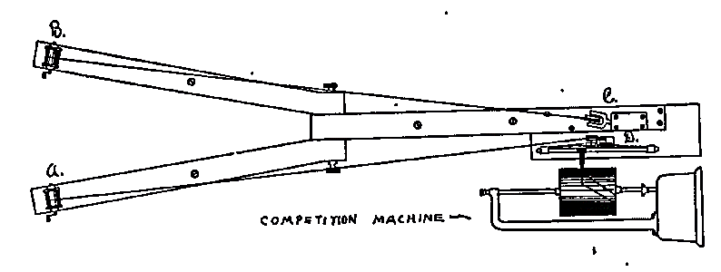

{{< interactive-figure relatedSamplesCover makeSampleComparisonCover options='{"related":true}' fallback="Two block distributions in distinct blue shades building up from paired observations." >}}



:::::::: {.content-visible when-profile="draft"}

<!-- WIP: everything below is hidden on the published site (it shows a "Coming soon!" placeholder instead).
     When this chapter is ready, delete the include above, this comment, and the two :::::::: fences. -->

This will be our last chapter on the $t$ statistic. We'll introduce one more variant of the $t$ test, the related-samples $t$ test, which is used when we want to compare two samples but, unlike the independent samples in the previous chapter, the two samples are somehow related. We'll discuss the kind of research designs that this involves, the pros and cons of related and independent designs, and we'll learn how to calculate the related-samples $t$ test, paying attention to how it differs from the independent-samples $t$ test.

## The competition machine

First, a little game for you to play. You're going to turn a handle (by moving your mouse or finger in circles) to move a little blue flag along a race track. Try your best, and have fun!

::::: {#act-triplett-race .callout-tip .interactive}
## The competition machine

{{< interactive-figure triplettRace makeTriplettRace options='{"tutorial":true}' fallback="A game based on Triplett's competition machine: wind a reel to send a flag around a track four times, first alone and then racing a rival flag. It needs JavaScript." >}}

:::: {.callout-footer}
::: {.tutorial-step data-title="Practice" data-action='{"phase":"practice","advanceOnFinish":true}'}
You'll start by practicing moving the flag, just so you can see how the game works. In the real race you'll do 4 laps, but for practice just 2. Click the start button when you're ready.
:::

::: {.tutorial-step data-title="Alone" data-action='{"phase":"alone","advanceOnFinish":true}'}
Now for the real thing! You'll do 4 laps by yourself, and your time will be recorded. Press start when you're ready.
:::

::: {.tutorial-step data-title="Competition" data-action='{"phase":"competition","advanceOnFinish":true}'}
A challenger appears! You'll race again, but now against the red flag! Click start when you're ready.
:::

::: {.tutorial-step data-title="Results" data-action='{"phase":"results"}'}
How'd it go? Feel free to play again if you like, but take a moment to think about this first pair of races. Did you beat that devious red flag? Whatever your times were, did you do *better* when you were racing against a competitor than alone? That's the important question for us.
:::
::::
:::::

This is a little digital recreation of one of my favorite studies in the history of psychology. In fact, it is often credited as being the first published experiment in social psychology--though like many such claims, that's questionable. It was conducted by Norman Triplett as part of his master's research at Indiana University, and published in 1898. He was interested in how racing alone or against competitors might affect performance. This is now known as **social facilitation**: the idea that the presence of other people can improve our performance on some kinds of tasks [@triplett1898dynamogenic].

At first, Triplett examined cycling records, comparing unpaced rides against the clock, rides with someone setting the pace, and competition races. He compared averages and graphed patterns in the data, finding some evidence that multiple cyclists racing together might produce faster times than people racing against the clock.

But Triplett realized he needed some more convincing, more carefully controlled data. So he devised the "competition machine": a clever apparatus disguised as a children's game. Two fishing reels were secured to the end of a Y-shaped apparatus that was clamped on top of a heavy table. Bands of silk cord were run over the axles of the reels and across two pulleys, so that turning the reel would cause a small flag sewn into the silk to move around the four-meter circuit. The task was to turn the reel and complete the circuit four times as quickly as possible. Triplett had children do this a number of times, either by themselves or facing off against another kid.

{#fig-triplett}

What makes the paper so charming is that, because the $t$ test hadn't yet been developed, Triplett included full tables of the raw data in his paper, including the first names and last initials of the children. Compared to modern results sections filled with impersonal aggregate statistics, it's a delight to imagine little Violet F. and Willie H. staring each other down across the competition machine, teeth gritted in determination, Triplett watching on with clipboard in hand. He noted some wonderfully specific details. "An intense desire to win," Triplett wrote, was often accompanied by "labored breathing, flushed faces and a stiffening or contraction of the muscles of the arm." The youngest children sometimes became so excited that they could barely turn the crank; "The effort to continue turning in these cases was by a swaying of the whole body." One particularly competitive five-year-old was so upset at losing his race, according to his mother, that he "felt badly about it all day."

Anyway, this gives us a context in which to think about the consequences of this kind of research design, in which each participant does something more than once, and the statistical approach to the resulting data.

### Between- and within-participants designs

This requires some more thought about research design. In Chapter 12, we used a **between-participants design**: each participant experienced and contributed data to a single condition of our study. In the spending example, everyone spent their ten dollars either on themselves or on someone else, not both.

::: {#fig-design-dots-independent}
{{< interactive-figure independentDesignDotsReprise makeScoreRows options='{"groups":[{"name":"Sample A","values":[2.1,3.4,4.9,6.2,7.5]},{"name":"Sample B","values":[2.8,4.4,5.3,6.9,8.6]}],"axis":false,"colorBy":"person","ariaLabel":"Independent samples: two rows of five dots, every dot a different color, so ten different people each contribute one score.","maxWidth":"34rem"}' fallback="Independent samples: ten different people, five in each sample." >}}

Independent samples contain different, independent groups of people, represented here by 10 different colored dots. 
:::

Because it's a completely different group of people in each sample, there are at least two reasons why our sample means might differ from one another. One is any treatment effect that increases or decreases scores overall. That's what we're hoping to discover. But another reason is just the individual differences between those different groups of people. By chance, one group might have a few more people who score high on our measure and the other group a few more people who score low. In the top illustration below, each dot is a different person, and its position shows their score. One sample could happen to get more of the high scorers even if there's no treatment effect. Those individual differences are a potential source of variability that we have to keep in mind.

Now, compare that to a **related-samples design**, in which each score in one sample is paired with a specific score in the other. The most common version is the **within-participants design**, also called a *repeated-measures design*. Every participant experiences and contributes data to both conditions. When you played the game in @act-triplett-race, you produced two scores, one alone and one in competition. That's what Triplett got from each of the kids he tested.

There are still individual differences *within* each sample, because each sample is made up of different people. But it's those same people (represented by the same colored dots) in each sample. A child who is generally slow contributes a score to both conditions, so that stable difference in overall speed doesn't explain the difference between conditions. When the paired scores tend to go together, taking those stable differences out of the comparison can give us a more powerful test. (Other things could still change between the two measurements, though, like practice or fatigue. We'll come back to those when we interpret the results.)

::: {#fig-design-dots-related}
{{< interactive-figure relatedDesignDots makeScoreRows options='{"groups":[{"name":"Sample A","values":[2.1,3.4,4.9,6.2,7.5]},{"name":"Sample B","values":[3.0,4.6,5.7,7.4,8.3]}],"paired":true,"connectors":true,"axis":false,"colorBy":"person","ariaLabel":"Related samples: two rows of the same five colored dots, each person joined to their own second score. Each person scores a little higher in Sample B.","maxWidth":"34rem"}' fallback="Related samples: the same five people in both samples, each joined to their own second score." >}}

In a within-participants design, the same people contribute a score in each condition. The groups are not independent, represented by the line connecting each pair of same-colored dots.
:::

#### Matched-subjects designs

Another variation of the related-samples design is what's called a **matched-subjects design**, or *matched-samples design*. We have two samples of different people, but each individual in one sample is deliberately paired with someone similar in the other.

Say we didn't want the same kids to repeat the reel-turning task alone and in competition. We have one group of kids do it alone, and a different set of kids do it with a competitor. We might match children on age, since it's plausible that older children could turn the reels faster. For each pair of children of the same age, we'd randomly assign one to perform alone and the other to perform in competition. Each child contributes a score in just one condition, but we compare the two scores within each matched pair. These are the pairs we use in the analysis; they aren't the two children racing against each other.

Age is our **matching variable**: the characteristic we use to form the pairs. If we gave the alone and competition conditions the same mix of ages, age couldn't explain a difference simply because one condition had older children. But children of the same age could still differ in strength, coordination, or experience. Matching approximates the advantages of measuring the same people twice, at least as far as the variables we've decided to match people on. It works best when those variables help predict the scores we're measuring.

### Pros and cons

There's a practical advantage to measuring the same people twice: to get five scores in each condition, a within-participants study needs five people rather than ten. Participants can be expensive and time consuming to recruit, especially if we're not just using intro psych students and giving them course credit. Getting two measurements from each person can offer greater value for money. A matched-subjects design doesn't have that advantage. How many pairs we need for a particular level of power depends on how variable the differences are.

A within-participants design also lets us study changes within individuals over time. Remember the cognitive behavioral therapy (CBT) study for obsessive-compulsive disorder from Chapters 5 and 8? Researchers used the Dimensional Obsessive-Compulsive Scale (DOCS) to measure people's symptoms before and after treatment [@abramowitz2010docs]. (You'll finally get to analyze the data from that study appropriately in the learning checks at the end of this chapter!)

But people might stop treatment or miss the follow-up assessment. That's **dropout**. For the related-samples test, we need both measurements to calculate each person's difference score, so someone with only a pretreatment score can't contribute a complete pair. We may need to recruit more people than the number of complete pairs we want. And if those who drop out differ from those who stay---perhaps they're the people who aren't finding the treatment helpful---the remaining pairs could give us a misleading picture.

<!--  -->

## From two samples to one

Let's use some of Triplett's own data to make things concrete. His procedure was a bit more complicated than I'm making out here, but for our purposes we'll take just the first five kids from one of the paper's tables. Following a practice trial, all these kids first did a race alone, then with a competitor. @tbl-triplett shows the data. (I've rounded the times to whole seconds to keep the math more manageable. Note also that the race took much longer overall on Triplett's machine than the version you played in @act-triplett-race.) Triplett grouped these five kids among those whose performance generally improved in competition, so this selected example is for learning the procedure, rather than estimating the overall effect in his study.

| Participant | Alone | Competition |
|:------------|--:|--:|
| Violet F. | 54 | 43 |
| Anna P. | 67 | 57 |
| Willie H. | 38 | 39 |
| Bessie V. | 46 | 41 |
| Howard C. | 42 | 36 |

: Times (in seconds) from Triplett's competition-machine study. {#tbl-triplett}

<!-- PLAN: quick multiple-choice quiz here (one click, not free-response),
     before the rhetorical question below answers it. Readers commit to a
     guess about what the rows tell us that two separate columns would hide
     (each row is one child; stable differences in overall speed), and the
     "From pairs to differences" tutorial then resolves it. Could tie back
     to the game, e.g. a classmate who is slow both alone and in competition.
     Would be quizzes/13-related-t-pairs.qmd, included on its own line. -->

If we ignored the Participant column, the data would resemble the kind of scores from independent samples that we worked with in the last chapter. But the column of names tells us that each row comes from one child; the scores are related. The children differ in their overall speed. Anna P. took quite a bit longer than Willie H. in both conditions. But the comparison we're interested in is how each child's *own* time changed. We need a way to distill that information when we compare the conditions.

Let's look at this visually, like we did for independent samples last time, before we walk through the equations.

::::: {#act-triplett-pairs .callout-tip .interactive}
## From pairs to differences

{{< interactive-figure triplettScoreRows makeScoreRows options='{"groups":[{"name":"Alone","values":[54,67,38,46,42]},{"name":"Competition","values":[43,57,39,41,36]}],"paired":true,"personLabels":["Violet F.","Anna P.","Willie H.","Bessie V.","Howard C."],"axisLabel":"Time to finish (seconds)","xMin":30,"xMax":70,"meanLabel":"mean","differences":{"label":"Difference","axisLabel":"Competition − alone (seconds)","tAxisLabel":"t (standard errors from 0)","meanLabel":"mean difference"},"colorBy":"person","tutorial":true,"maxWidth":"38rem"}' fallback="Triplett's five children: their times alone (54, 67, 38, 46, 42 seconds) and in competition (43, 57, 39, 41, 36 seconds), then each child's difference score, competition minus alone: −11, −10, 1, −5, −6 seconds, with mean difference −6.2." >}}

:::: {.callout-footer}
::: {.tutorial-step data-title="Scores" data-action='{"tScale":false,"stage":"scores","spread":"sd","meanGap":false,"animate":false,"colorBy":"person"}'}
Here are the five children's times in each condition, arranged on a horizontal axis. The condition means differ, but there is also considerable spread within each row: the SDs are 11.5 and 8.1 seconds. An independent-samples test would incorporate this into its standard error. But notice each child has the same color dot in both rows. The related-samples analysis makes use of this pairing.
:::

::: {.tutorial-step data-title="Pairs" data-action='{"tScale":false,"stage":"pairs","spread":"none","meanGap":false,"colorBy":"person"}'}
Joining lets us focus on each child's *change*. The children differ considerably in their overall speed, but the lines show a more consistent pattern. Four of the five kids were faster in competition than alone.
:::

::: {.tutorial-step data-title="Differences" data-action='{"tScale":false,"stage":"differences","spread":"none","meanGap":false,"colorBy":"person"}'}
To quantify this, we need to compute the differences: subtract each child's alone time from their competition time. Visually, each pair of dots slides over to the average of the whole Alone condition and moves down to a new "Difference axis." So the ten original times become five difference scores: −11, −10, 1, −5, and −6 seconds.
:::

::: {.tutorial-step data-title="Difference" data-action='{"tScale":false,"stage":"differences","spread":"none","meanGap":true,"colorBy":"person"}'}
The mean of those differences is −6.2 seconds: the children were 6.2 seconds faster in competition, on average. The bracket runs from zero, the null hypothesis's mean difference, to −6.2. This signed difference is the numerator of $t$.
:::

::: {.tutorial-step data-title="Spread" data-action='{"tScale":false,"stage":"differences","spread":"sd","meanGap":true,"colorBy":"person"}'}
The difference scores have a standard deviation of 4.76 seconds, smaller than either set of scores on its own. (We saw those condition SDs in step 1; they're shown again here faded.) Subtracting within each pair removes stable differences in the children's overall speed. Pairing reduces variability when the two measurements are positively related, as they are here.
:::

::: {.tutorial-step data-title="Standard error" data-action='{"tScale":false,"stage":"differences","spread":"se","meanGap":true,"colorBy":"person"}'}
Now we can treat the five difference scores as one single sample. As in Chapter 11, the SD gets divided by $\sqrt{n}$, so it shrinks relative to the standard deviation. The red segment shows one estimated standard error, starting at zero and extending toward the mean difference. This provides the denominator of the $t$ statistic.
:::

::: {.tutorial-step data-title="t" data-action='{"tScale":true,"stage":"differences","spread":"se","meanGap":true,"colorBy":"person"}'}
Dividing numerator by denominator relabels the lower axis in standard errors from zero. In this case, the observed mean difference represents $\approx -2.91$ standard errors. The sign is negative because we calculated competition minus alone, and competition times were lower on average.
:::
::::
:::::

At first, the structure of the data for the related-samples design looks similar. We have two samples of scores, but crucially, the two samples are no longer independent. They consist of the same people, or people we've deliberately paired up to be similar. So if we treated this data the same way we treat the independent-samples data, we'd be violating the assumption of independence of scores.

So rather than treating the two sets of scores separately, we turn them into a *single sample of difference* scores. We subtract each child's time alone from their time in competition to get the **difference score**, $D$, and we can put that as a new column in our table.

| Participant | Alone | Competition | $D$ |
|:------------|--:|--:|--:|
| Violet F. | 54 | 43 | $-11$ |
| Anna P. | 67 | 57 | $-10$ |
| Willie H. | 38 | 39 | $1$ |
| Bessie V. | 46 | 41 | $-5$ |
| Howard C. | 42 | 36 | $-6$ |

: Triplett's times with each child's difference score, $D = \text{Competition} - \text{Alone}$. {#tbl-triplett-d}

Negative differences mean faster times in competition; positive differences mean slower times. We could subtract in the other direction, but we need to keep the direction the same for every row. Reversing it would reverse the signs of the mean difference and $t$, without changing our two-tailed test decision.

With the single set of difference scores, we're back conceptually closer to the single-sample $t$ test that we worked with in Chapter 11. We have a single sample of difference scores and we want to know the characteristics of the population of difference scores that produced them.

@fig-related-inferential shows this logic, using the same kind of diagram as @fig-t-estimated-population and @fig-independent-inferential. On the left, the design looks like the independent-samples design, with two treated samples. But now they come from a single sample: the same people receive both treatments. Subtracting within each pair turns the two treated samples into one sample of difference scores. From there, the right side is the single-sample $t$ test again, with a subscript $D$ added. The treated population is now a population of difference scores, and we compare its unknown mean, $\mu_D$, with the reference value of $0$ that the null hypothesis specifies.

::: {#fig-related-inferential}
{{< interactive-figure relatedInferentialDiagram makeInferentialDiagram options='{"preset":"related","maxWidth":"42rem","ariaLabel":"One sample from the original population receives both treatments, giving two treated samples made up of the same people. Subtracting within each pair gives a single sample of difference scores, which supplies M D, n, and s D. From it we make an inference about the unknown mean mu D of the treated population of differences, and ask whether it is the same as the reference population, where mu D is specified as 0 and sigma D is unknown."}' fallback="One sample from the original population receives both treatments; subtracting within each pair gives difference scores with M_D, n, and s_D; inference to the treated population's unknown μ_D; is it the same as the reference value μ_D = 0?" >}}

A diagram representing the logic of the related-samples $t$ test. One sample receives both treatments, and the paired scores become a single sample of differences. The rest is the logic of the single-sample $t$ test, applied to difference scores, with a reference mean of $\mu_D = 0$.
:::

## The related-samples $t$ statistic

Remember that every $t$ statistic has the same basic structure (@eq-t-structure):

$$ t = \frac{\text{sample statistic} - \text{population parameter}}{\text{estimated standard error}} $$

For the single-sample $t$ test, the null gave us a reference value for the population mean, $\mu_0$ (@eq-t-statistic):

$$ t = \frac{M - \mu_0}{s_M} $$

For the independent-samples $t$ test, the statistic was the difference between sample means, and the null said the difference between population means was zero (@eq-independent-t):

$$ t = \frac{(M_1 - M_2) - (\mu_1 - \mu_2)}{s_{M_1 - M_2}} $$

Conceptually, the related-samples $t$ test is just the single-sample $t$ test, applied to difference scores. We just add a $D$ subscript to things to show that we're dealing with difference scores rather than the original scores: $M$ becomes $M_D$, the mean of the difference scores; $s$ becomes $s_D$; and $s_M$ becomes $s_{M_D}$. The parameter becomes $\mu_D$. As in Chapter 12, we're writing the parameter itself because it's about a hypothesized difference, and the null hypothesis says its value is zero:

$$ t = \frac{M_D - \mu_D}{s_{M_D}} $$ {#eq-related-t}

The denominator is the **estimated standard error of the mean difference score**, $s_{M_D}$. Don't confuse it with Chapter 12's estimated standard error of the mean difference, $s_{M_1 - M_2}$. The means themselves can match: for our children, the mean of the differences, $-6.2$, is the same as the difference between the two condition means, $43.2 - 49.4$. But the two standard errors are calculated differently, and as we'll see later in the chapter, that can make a big difference to the resulting $t$. As in Chapter 11, $s_{M_D}$ estimates how much the mean of the difference scores would vary from sample to sample. To calculate it, we divide the sample standard deviation of the difference scores, $s_D$, by the square root of the number of pairs, $n$:

$$ s_{M_D} = \frac{s_D}{\sqrt{n}} $$ {#eq-related-se}

So once we've calculated our differences, everything works just like the single-sample test. With a null mean difference of zero, the parameter is irrelevant mathematically---we just divide $M_D$ by its estimated standard error to see how many standard errors our observed mean difference falls from zero.

### Degrees of freedom

We'll need to know the degrees of freedom for the $t$ test. Here it's $df = n - 1$, where $n$ counts complete pairs, or difference scores. In a within-participants study, each person contributes one difference score. In a matched-subjects study, each matched *pair* of people contributes one difference. So our five children supply ten original times, but only five difference scores, giving $df = 4$.

### All the $t$s

@tbl-t-structure-comparison-related adds the related-samples test to the comparison from Chapter 12 so we can see all the pieces of each of the $t$ statistics we've learned about. It might look like a lot of different things, but if you can see the common threads behind the different symbols, it's a good sign that you're understanding the structure of the $t$ statistic, rather than just trying to memorize formulas.

| | Single-sample $t$ | Independent-samples $t$ | Related-samples $t$ |
|:--|:--|:--|:--|
| Sample statistic | $M$ | $M_1 - M_2$ | $M_D$ |
| Parameter under $H_0$ | $\mu_0$ | $\mu_1 - \mu_2 = 0$ | $\mu_D = 0$ |
| Variability estimate | $s^2$ | $s_p^2$ (pooled) | $s_D^2$ |
| Estimated standard error | $s_M$ | $s_{M_1 - M_2}$ | $s_{M_D}$ |
| Degrees of freedom | $n - 1$ | $(n_1 - 1) + (n_2 - 1)$ | $n - 1$ (pairs) |

: The pieces of the three $t$ statistics. All follow the structure of @eq-t-structure, and the related-samples column is the single-sample column with a $D$ subscript. {#tbl-t-structure-comparison-related}

## A related-samples $t$ test, step by step

So let's run through the familiar hypothesis testing steps with Triplett's five kid racers. Again, the only really new part is how we prepare the data: each child supplies one difference score, and those five differences become the sample we analyze.

### Step 1: State the hypotheses

The null hypothesis says that the population mean difference is zero. We'll use a nondirectional alternative, looking for a difference in either direction:

$$ H_0: \mu_D = 0 $$

$$ H_1: \mu_D \ne 0 $$

### Step 2: Set the decision criteria

Our nondirectional alternative calls for a two-tailed test. The critical regions depend on the degrees of freedom. For the related-samples test, degrees of freedom is $n - 1$, meaning the number of scores we're analyzing minus 1. Remember, we're analyzing the difference scores, not every individual score across the two conditions. So here it would be four (not nine; the ten recorded times produced five difference scores). 

To find the corresponding critical values, we consult the same kind of $t$ table that appeared in Chapter 11. The critical values for a two-tailed $\alpha$ of .05 with four degrees of freedom would be $\pm 2.776$.

::: {#tbl-related-critical}
{{< interactive-figure relatedTCriticalTable makeTTable options='{"title":"Critical values for Triplett’s data","df":{"from":2,"to":6},"alphas":[0.1,0.05,0.025,0.01,0.005],"tableMinWidth":"0","maxWidth":"32rem","confidence":false,"interactive":false,"selected":{"df":4,"tail":"two","alpha":0.05}}' fallback="t table excerpt for 2 through 6 degrees of freedom, highlighting the two-tailed .05 critical value of 2.776 at df = 4." >}}

An excerpt of the $t$ table, with the $df = 4$ row highlighted.
:::

### Step 3: Collect and analyze the data

To calculate our statistic, we work with the difference scores just like any single sample of scores: find their mean, then their deviations from that mean, squared deviations, sum of squares, variance, and standard deviation.

::: {#tbl-triplett-differences}
{{< interactive-figure triplettDifferencesTable makeVariabilityTable options='{"data":[{"name":"Violet F.","alone":54,"competition":43,"D":-11},{"name":"Anna P.","alone":67,"competition":57,"D":-10},{"name":"Willie H.","alone":38,"competition":39,"D":1},{"name":"Bessie V.","alone":46,"competition":41,"D":-5},{"name":"Howard C.","alone":42,"competition":36,"D":-6}],"columns":[{"key":"name","label":"Participant"},{"key":"alone","label":"Alone","numeric":true},{"key":"competition","label":"Competition","numeric":true}],"value":"D","sample":true,"valueSymbol":"D","meanSymbol":"M_D","varianceSymbol":"s^2_D","sdSymbol":"s_D","summaryDigits":"auto","maxWidth":"40rem","stage":"sd","controls":false}' fallback="Table of Triplett's data: alone and competition times, difference scores, deviations, and squared deviations for five participants, with M_D = -6.2, SS = 90.8, s^2_D = 22.7, and s_D = 4.76." >}}

Difference scores and their deviations.
:::

$$s_{M_D} = \frac{s_D}{\sqrt{n}} = \frac{4.76}{\sqrt{5}} \approx 2.13 $$

$$ t = \frac{M_D - \mu_D}{s_{M_D}} = \frac{-6.2 - 0}{2.13} \approx -2.91 $$

### Step 4: Make a decision

Our $t = -2.91$ falls below the lower critical value of $-2.776$, so we reject the null hypothesis. These children were faster in competition, on average.

::: {#fig-related-decision}
{{< interactive-figure relatedTestDecision makeDistributionGraph options='{"color":"var(--sfs-null-color, currentColor)","distribution":"t","df":4,"title":"Null distribution: df = 4","style":"minimal","xAxis":true,"yLabel":false,"xDomain":[-5,5],"xTicks":5,"labels":{"x":"t statistic"},"shade":{"tail":"two","alpha":0.05},"markers":[{"at":-2.776445,"label":"−2.776","height":0.6,"labelAnchor":"start","color":"var(--sfs-critical-color, #c63f3f)"},{"at":2.776445,"label":"+2.776","height":0.6,"color":"var(--sfs-critical-color, #c63f3f)"},{"at":-2.909804,"label":"t = −2.91","height":0.6,"labelAnchor":"end","color":"var(--sfs-accent, #2c7fb8)"}],"maxWidth":"42rem"}' fallback="Null t distribution with 4 degrees of freedom. The two rejection regions lie beyond ±2.776; the observed t of −2.91 is just inside the left rejection region." >}}

The observed $t = -2.91$ falls just inside the lower critical region of the null $t$ distribution with $df = 4$.
:::

The corresponding two-tailed $p$-value is approximately $.044$, just below our $\alpha$ of $.05$. The result passes the threshold for significance, but with only five difference scores, there's still considerable uncertainty about the size of the population mean difference, as we'll see in the confidence interval.

### Step 5: Estimate the effect, interval, and power

#### Effect size

As before, we should also estimate the effect size, whether or not the result is significant. Cohen's $d$[^related-effect-size] works like the single-sample version: divide the mean difference by the standard deviation of the differences:

$$ d = \frac{M_D}{s_D} = \frac{-6.2}{4.764} \approx -1.30 $$

The mean difference is about 1.3 standard deviations of the differences below zero.

[^related-effect-size]: You may see this version written $d_z$ elsewhere. That has nothing to do with $z$-scores: Cohen used $Z$ to stand for the difference score, $Z = X - Y$, which we've been calling $D$. There are also other ways to standardize an effect in a repeated-measures design. The choice matters when comparing effect sizes across designs; see Lakens [-@lakens2013calculating].

#### Confidence interval

The confidence interval works just like the single-sample interval, too, but now we're estimating the population mean difference:

$$ M_D \pm t \times s_{M_D} = -6.2 \pm 2.776(2.131) \approx [-12.12,\ -0.28] $$

The interval ranges from about twelve seconds faster in competition to a fraction of a second faster. That's still a wide range. Notice that it barely excludes zero, agreeing with our two-tailed test's $p$-value of about $.044$, only just squeaking past the $\alpha = .05$ threshold.

::: {#fig-related-ci}
{{< interactive-figure relatedConfidenceInterval makeIntervalDiagram options='{"distribution":"t","m":-6.2,"s":4.764452,"n":5,"confidence":95,"reference":0,"xDomain":[-15,5],"units":"Mean difference, competition − alone (s)"}' fallback="95% t confidence interval for the mean difference: −12.12 to −0.28 seconds, with point estimate −6.2 seconds. Zero lies just above the interval." >}}

The 95% $t$ interval for the mean difference excludes zero, agreeing with the two-tailed test at $\alpha = .05$.
:::

#### Statistical power

As in Chapters 11 and 12, power is more useful for planning a future study than for describing the result we've already found. Say we consider a three-second difference worth detecting, in either direction. How many children would we need?

The calculation is the same as for the single-sample test in Chapter 11. But the standard deviation we need is the standard deviation of the *differences*, not the standard deviation of the times in either condition. Our five differences give an estimate of $s_D = 4.76$ seconds. A three-second change is about $3/4.76 = 0.63$ standard deviations of the differences. Using the normal approximation from Chapter 9, with a two-tailed $\alpha = .05$ and power of .80:

$$ n \approx \frac{(1.96 + 0.84)^2}{(3/4.76)^2} \approx 19.7 $$

Rounding up, that's 20 children, each measured in both conditions. An exact calculation using the $t$ distribution gives 22. Here $n$ counts pairs, so a matched-subjects study would need 22 pairs, or 44 people.

The hard part is estimating how variable the changes will be. Two conditions could each have a lot of variability, but if the same people score high in both, their differences could be much less variable. That's what happened here. And our estimate comes from only five children, so we shouldn't treat it as a precise description of the population.

<!-- ### Try it with some different children

Now try the procedure yourself. These five children are from Table II, Group A, which Triplett described as stimulated adversely by competition [@triplett1898dynamogenic]. As in our worked example, we'll use their first trial alone and their first trial in competition, rounded to whole seconds.

| Participant | Alone | Competition |
|:------------|--:|--:|
| Jack R. | 44 | 44 |
| Helen F. | 44 | 51 |
| Emma P. | 38 | 42 |
| Warner J. | 42 | 44 |
| Genevieve M. | 36 | 36 |

: Practice times in seconds, rounded from Triplett's Table II, Group A. {#tbl-triplett-practice}

Use $D = \text{Competition} - \text{Alone}$ again, and test $H_0: \mu_D = 0$ against $H_1: \mu_D \ne 0$, with $\alpha = .05$. This is practice with a selected group of children, rather than a test of the overall effect of competition in Triplett's study.

 -->

## Reporting and interpreting the results

### Reporting results

As usual, we need to report the descriptive statistics, the kind of test, the estimated difference and its confidence interval, the test statistic with its degrees of freedom, the $p$-value or whether it falls below $\alpha$, and the effect size. Here's how we might report our worked example:

> In this selected five-child example, children completed the task faster in competition ($M = 43.2$, $SD = 8.14$ seconds) than alone ($M = 49.4$, $SD = 11.48$ seconds). A two-tailed related-samples $t$ test found a significant mean difference, $M_D = -6.20$ seconds, 95% CI [-12.12, -0.28], $t(4) = -2.91$, $p < .05$, $d = -1.30$.

### Assumptions of the related-samples $t$ test

The difference scores must be independent of one another. We expect the two scores within a pair to be related; that's why we put them together. But one child's change shouldn't depend on another child's change. In a matched-subjects study, each matched pair contributes one difference, and those differences need to be independent across pairs. For Triplett's data, we'd also want to know who raced against whom, since opponents could influence each other's performances.

And second, there's the familiar assumption about normality. As with the single-sample test, the exact $t$ reference distribution assumes a normal population, but here it's the population of *difference scores* that matters. Neither condition has to be normally distributed separately. Larger samples can tolerate some departures, but strong skew or extreme differences deserve attention, especially with only five pairs.

### Interpreting the results

The result we found was "statistically significant," in a direction consistent with social facilitation: better race performance when racing against a competitor. As usual though, we would still need to be cautious in our interpretation. Is social facilitation the only possible explanation for the difference? Given the miniscule sample size, certainly not; the difference met the statistical threshold for significance but the inherent imprecision in such a small sample means we shouldn't be too confident that the next small sample would produce a similar result. We ought also to be cautious about how much any effect might generalize to other children. (Remember, for our analysis we used the data from five children Triplett specifically classified as "stimulated positively" by competition.)

There's also a problem with the particular pairs of scores we analyzed: every child did the alone trial first and the competition trial second. Maybe some of the improvement was just getting better at turning the reel through practice. Or maybe they were getting tired, which could push their times in the other direction. This is an **order effect**: a change in performance or responses caused by the order in which the conditions are experienced. (Triplett anticipated this problem. Each child completed six timed trials, and he varied the sequence of alone and competition trials across two groups. But everyone started alone [@triplett1898dynamogenic]. Our first-pair-only analysis leaves out his attempts to separate practice from competition.)

One way to deal with order effects is **counterbalancing**. In a simple two-condition study, we could have some children do the alone trial first and others do competition first. That way, extra practice or fatigue on the second run wouldn't always go along with the same condition. Using the same children twice removes stable differences in their overall speed, but it doesn't remove things that change between runs.

So our significant result here doesn't establish an overall effect in Triplett's data. But what's the status of the research? Triplett didn't even have tools like the $t$ test to analyze data. A later reanalysis of his published data using modern statistical approaches found little convincing evidence that competition improved performance overall [@strube2005triplett].

Triplett gave us an ingenious way to investigate an interesting question, even if his results didn't settle it. But the competition machine got another outing. In 2025, researchers reported a replication with 445 children using an apparatus built from Triplett's diagrams. Children were faster alongside another child than alone, even after accounting for practice, though they weren't explicitly told to compete [@mchugh2025replication]. It's still not conclusive---no single piece of research is. But it's encouraging evidence for the idea Triplett was pursuing.

## What pairing buys

What if we hadn't realized that each row belonged to one child? Let's briefly forget everything we just learned about related samples and subject the same data we just worked with to an independent-samples $t$ test. This treats the two sets of times, for alone and competition, as if they came from different children, and uses Chapter 12's equations and test.

With a two-tailed test, $\alpha = .05$, and $df = 5 + 5 - 2 = 8$, our critical $t$ values would be $\pm 2.306$. The competition times are sample 1, with variance $s_1^2 = 66.2$; the alone times are sample 2, with $s_2^2 = 131.8$. Pooling them weights each variance by its degrees of freedom:

$$ s_p^2 = \frac{df_1 s_1^2 + df_2 s_2^2}{df_1 + df_2} = \frac{4(66.2) + 4(131.8)}{4 + 4} = 99 $$

With equal sample sizes, the pooled variance is just the average of the two. The estimated standard error of the mean difference is $s_{M_1 - M_2} = \sqrt{99/5 + 99/5} \approx 6.29$. And the $t$ statistic works out to $-6.2/6.29 \approx -0.99$, so this calculation would fail to reject the null hypothesis.

We already saw that the correct analysis, treating the scores as related and analyzing the differences, produced a more extreme $t$ statistic, which was sufficient to reject the null hypothesis (despite the lower $df$ and correspondingly more extreme critical $t$ values). By accounting for each child's two scores belonging together, we were able to perform a more powerful test.

Here's what changes when we account for the pairs.

| Quantity | Ignoring the pairs | Using the pairs |
|:--|--:|--:|
| Mean difference (seconds) | $-6.2$ | $-6.2$ |
| Estimated standard error (seconds) | $6.29$ | $2.13$ |
| Degrees of freedom | $8$ | $4$ |
| Critical values, two-tailed $\alpha = .05$ | $\pm 2.306$ | $\pm 2.776$ |
| $t$ | $-0.99$ | $-2.91$ |
| Two-tailed $p$ | $.353$ | $.044$ |
| 95% confidence interval (seconds) | $[-20.71,\ 8.31]$ | $[-12.12,\ -0.28]$ |

: The same scores analyzed with and without their known pairing. The independent-samples calculation is inappropriate for these paired observations. {#tbl-related-comparison}

The mean of the differences is exactly the difference between the sample means, so both numerators are the same. What changes is the variability we used to calculate the denominator. The independent-samples calculation includes how much the children differ in their overall speed. The related-samples calculation uses how much their *changes* differ; it excludes the individual differences that reflect some kids being faster than others and allows the analysis to focus on each child's change on their own terms. Here that's a much smaller number, so we get a smaller standard error and a narrower confidence interval, even though the lower degrees of freedom require a more extreme critical $t$.

Obviously which variety of $t$ test we use isn't a choice we make by trying both out and keeping the answer we prefer. My point is that the numbers don't know or care what we subject them to. We have to know where those numbers came from, and what the appropriate statistical tools are. These scores belong in pairs, so our analysis needs to use the pairs. Pairing doesn't guarantee greater power, but it helps when the two scores in each pair do tend to go together, as is the case for our data here.

## Looking ahead

Across these three chapters, the basic logic of the $t$ statistic hasn't changed. We take an estimate, subtract the value specified by the null hypothesis, and divide by an estimated standard error. What changes is the design, and so what we're estimating and how we calculate its uncertainty.

For related samples, the extra step is to turn each pair into a difference score. From there, we're back to the single-sample $t$ test: one mean, one standard deviation, and $n - 1$ degrees of freedom, with $n$ counting pairs. Keeping track of who supplied which score lets us take stable differences between people out of the comparison.

But what if we had more than two conditions? We might have children turn the reels alone, against one other child, and against two other children. We could compare every pair of conditions with a separate $t$ test, but doing that creates a new problem. That's where analysis of variance, or ANOVA, comes in next.



::::::::
